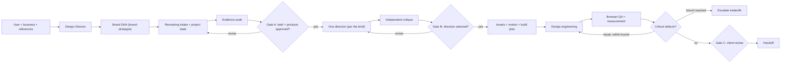
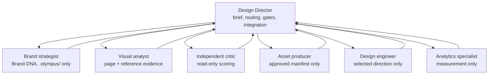

# Olympus architecture

## Workflow

## Routing table

| Need | Skill or capability | Activate when | Keep dormant when |
|---|---|---|---|
| Direct the run | `$olympus-design-director` | Always | Never |
| Brand DNA | `brand-strategist` agent (`$product-marketing`, `$competitor-profiling`, `$customer-research`, taste skills) | The project has no `.olympus/brand-dna.json`, or the business/audience/taste changed | A current `brand-dna.json` exists |
| Visual taste | `$convenium-taste-interview` (describe) or `$convenium-style-picker` (choose a doctrine) | The Brand DNA's `taste` is empty or low-confidence | Taste is already resolved from evidence |
| Diagnose existing UX/UI | `$ux-evidence-audit` | Existing page is supplied | Greenfield work with no existing interface |
| Decode references | `$reference-deconstruction` | Approved references exist | No references or only vague taste words |
| Ground the brief in research | `$customer-research` | Existing customer evidence (interviews, tickets, reviews, surveys) is available | No research assets, or a pure visual refresh of a known page |
| Plan information architecture | `$site-architecture` | Page/route hierarchy, navigation, or URL structure is in scope | Single existing route with a fixed IA that will not change |
| Generate the direction | `$concept-studio` | Gate A is approved | Before diagnosis |
| Independent scoring | `$award-rubric` | A direction is frozen | During authorship or implementation |
| Plan media | `$asset-director` | Chosen direction has missing media | Existing approved assets are sufficient |
| Component polish | Impeccable + `$awwwards-web-design` | Direction is selected and hierarchy is stable | Early ideation |
| Timed/scroll motion | Official GSAP skills | Narrative sequencing justifies it | Decorative motion or simple CSS transition |
| 3D/WebGL | `$webgl-experience` | Unique communication value passes activation test | Generic spectacle, weak devices, tight budget |
| Build 3D | `$threejs-build` (one reference at a time) | `webgl-experience` approved 3D | 3D not approved |
| Native platform patterns | `$modern-web-guidance` | A dialog, popover, tooltip, transition, scroll effect or layout the platform may now provide natively | Pattern already settled in `DESIGN.md` / the build plan |
| Write interface copy | `$copywriting` | The direction needs new headline / body / CTA / state text | Copy is fixed, supplied, or out of scope |
| Measurement | `$design-analytics` | Goal and analytics scope are known | No consent, no baseline, or concept-only run |
| Edit interface copy | `$copy-editing` | Implemented copy needs a clarity / consistency pass | Copy was written fresh this run and already reviewed |
| Release evidence | `$visual-qa` | An implementation exists | Before build |
| Browser captures | `$playwright-cli` | Audit or QA needs viewports, states or a11y snapshots | Evidence already in `.olympus/` for unchanged pages |
| Motion frame budget | `$animation-performance` | The build ships motion | Static build |

## Roles

The arrows are contracts, not free-form conversation. Each specialist receives: objective, allowed files, required evidence, output path, stop condition, and what it must not do.

## Brand DNA

Every project starts with the business, not the page. `brand-strategist` writes
`<project>/.olympus/brand-dna.json` (schema: `library/schemas/brand-dna.schema.json`) and a
readable `BRAND.md` (template: `templates/BRAND.md`):

- **business** — offer, audience with their jobs and objections, positioning, competitors and
  how they look, goals, the one action, constraints, voice;
- **taste** — the taste profile (`library/schemas/taste-profile.schema.json`), from an
  interview or a doctrine pick;
- **doctrineMatch** — one of `library/doctrines/`, chosen from business *and* taste, with the
  departures this business needs;
- **neededProducts** — what to make, ranked, confirmed by the user at Gate A;
- **sources** and **openQuestions** — what it was built from, and what it could not establish.

Two modes: *evidence* (the business has a public presence to analyse) and *interview-only*
(it doesn't). The DNA lives with the client project and is gitignored there by default; it is
never written into this repository. The director derives the `00-brief.md` direction block and,
later, the `DESIGN.md` token numbers from it.

What a run can make today: a **website** (the full gated pipeline above) and a **brand
identity** (`BRAND.md` plus doctrine-derived `DESIGN.md` tokens). Other `neededProducts`
kinds are recorded for later tracks — see the roadmap.

## Connecting a project

convenium.design is never copied into a project. Three ways to connect, all portable:

| Host | How | What loads |
|---|---|---|
| Claude Code | **Plugin** (recommended): `/plugin marketplace add <path or RustamG16/Apollo>`, `/plugin install convenium-design@convenium-design`. Generated by `project.py plugin` into `.claude-plugin/`. | Every skill as `convenium-design:<id>`, every agent as `convenium-design:<name>`; agents find convenium.design's files at `${CLAUDE_PLUGIN_ROOT}` |
| Claude Code | `claude --add-dir <convenium.design>` | `.claude/skills` and `.claude/agents` as project-level items (unnamespaced — personal skills with the same name can shadow them) |
| Codex (and either host) | `python library/tools/convenium.py attach <project>` | A pointer in the project's `AGENTS.md` to `.olympus/CONVENIUM.md`, which names the convenium.design folder; skills are read by path after routing from `ROUTING-DIGEST.md` |

`attach` also gitignores `.olympus/` (client research stays private) unless
`--commit-olympus` is passed. `convenium.py doctor` checks a machine; `verify.py` checks the repo.

**Bundle, don't depend.** Every skill a phase or an agent needs is a body in `library/` and is
projected to every host. Host plugin sets change between sessions on the same machine, so a
pipeline that routes to a plugin skill works some days and not others.

## MCP and tool layers

MCPs provide access; skills provide judgment. Connecting a service does not mean it should be called on every task.

| Layer | Preferred connection | Purpose | Trigger |
|---|---|---|---|
| Browser evidence | Codex browser control or Playwright CLI | Inspect, screenshot, test states | Audit and QA |
| Design source | Figma MCP | Frames, components, variables, assets | User supplies a Figma source |
| UI exploration | 21st.dev Magic MCP | Component inspiration/prototypes | Selected direction needs a net-new component pattern |
| Image/video | Higgsfield MCP | Approved media production | Asset manifest and user approval exist |
| Analytics | PostHog MCP | Baselines, funnels, events | Analytics is connected and in scope |
| Runtime debugging | Chrome DevTools MCP | Performance and browser diagnostics | Browser QA exposes a runtime/performance issue |

See `config/MCP-SETUP.md` for connection instructions and safeguards.

## Why the earlier all-at-once setup failed

Broad agents tend to load overlapping guidance, independently reinterpret the brief, generate before agreeing on hierarchy, and then critique moving targets. Every extra agent repeats context and creates another integration problem. The result is high token use with low design coherence.

Olympus instead uses one persistent interpretation of the brief, explicit human gates, activation tests for expensive tools, stable artifacts on disk, and a hard limit on revision loops.

## Roadmap — deliberately deferred

Recorded so the next pass starts from decisions, not rediscovery.

- **More tracks.** `marketing-media` (social kit, ads, video via `asset-director`,
  `higgsfield-*`, `remotion-*`) and `software-product` (six-files scaffold, then the
  engineering skills) consume `neededProducts[]`. Build one only when a real project needs it.
- **Knowledge base.** Reorganise `library/knowledge/` by what a run needs (design principles,
  industry playbooks — hospitality first — and system health) with a generated digest. SQLite
  full-text search only when the digest is measurably too large to load.
- **Remotion dedupe.** `remotion-best-practices` is an upstream router whose relative links
  point into nested copies of the other twelve remotion skills, and some copies differ from the
  top-level ones. Dedupe against upstream, not by hand.
- **Phase vocabulary.** Registry, agents and Studio use different phase names; unify only with
  a migration for `run.json` and Studio.
- **V3 harvest.** `unused/v3-apollo/` holds a WCAG contrast checker (`lib/contrast.mjs`), a
  token schema and an eval harness worth folding in as a regression suite.
- **Studio.** Optional and unchanged by the 2026-10-08 cleanup; its redesign plans live in
  `New_upgradePlan/` and `convenium-studio/docs/`.
